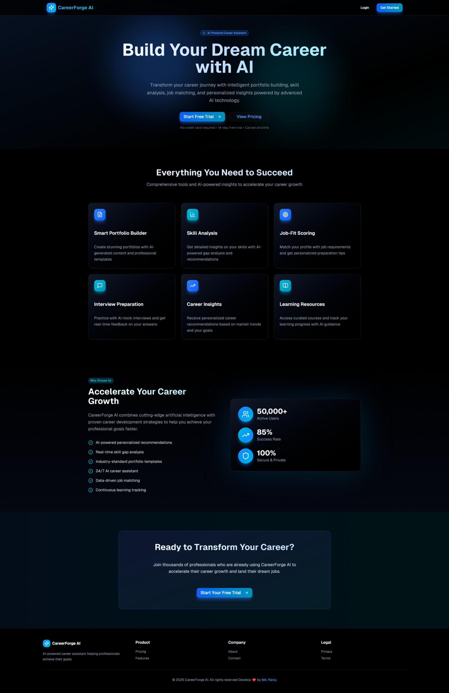
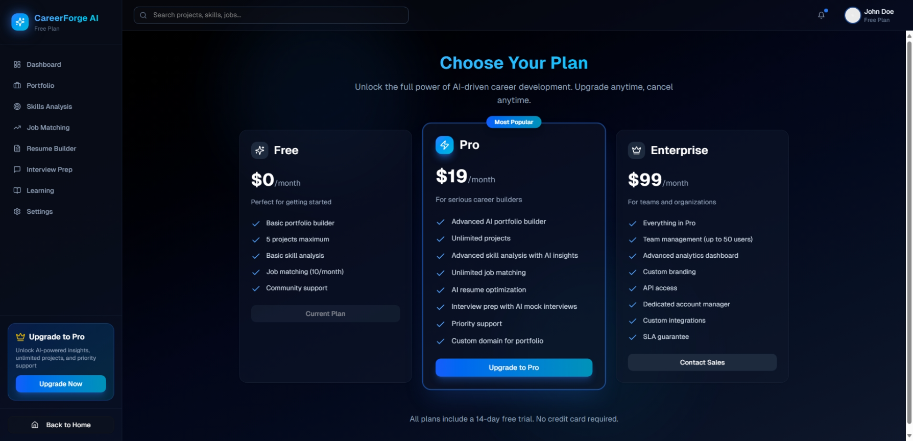

# CareerForge AI

## Overview

CareerForge AI is an AI-powered career builder and assistant designed to transform your professional journey. By leveraging advanced artificial intelligence, it provides personalized tools for building portfolios, analyzing skills, matching jobs, preparing for interviews, gaining career insights, and accessing learning resources. Whether you're a recent graduate, mid-career professional, or executive, CareerForge AI helps accelerate your career growth and land your dream job.

With over 50,000 active users and an 85% success rate in helping users achieve their goals, CareerForge AI ensures 100% secure and private data handling. It's built to combine cutting-edge AI with proven career strategies, offering real-time guidance and data-driven recommendations.

Live Demo: [CareerForge AI Website](https://careerforge-ai.vercel.app/)

## Key Features

- **Smart Portfolio Builder**: Create professional portfolios with AI-generated content and industry-standard templates.
- **Skill Analysis**: Get detailed insights into your skills, including AI-powered gap analysis and personalized recommendations to bridge them.
- **Job-Fit Scoring**: Match your profile against job requirements and receive tailored preparation tips for better alignment.
- **Interview Preparation**: Practice with AI-driven mock interviews and receive real-time feedback on your responses.
- **Career Insights**: Access personalized career recommendations based on market trends, your goals, and professional background.
- **Learning Resources**: Discover curated courses, track your learning progress, and get AI-guided suggestions for continuous development.

Additional highlights:

- AI-powered personalized recommendations
- Real-time skill gap analysis
- 24/7 AI career assistant
- Data-driven job matching
- Continuous learning tracking

## Why Choose CareerForge AI?

- **Comprehensive Tools**: Everything you need in one platform to succeed in your career.
- **Proven Results**: Join thousands of professionals who have accelerated their growth and secured dream jobs.
- **User-Friendly**: Intuitive interface with no steep learning curve.
- **Free Trial**: 14-day free trial, no credit card required, cancel anytime.
- **Secure**: 100% data privacy and security.

## Getting Started

### Prerequisites

- Node.js (version 18 or higher) – assuming a JavaScript-based frontend (based on Vercel deployment).
- Yarn or npm for package management.

### Installation

1. Clone the repository:
   ```
   git clone https://github.com/mdranju/careerforge-ai.git
   ```
2. Navigate to the project directory:
   ```
   cd careerforge-ai
   ```
3. Install dependencies:
   ```
   npm install
   ```
   (or `yarn install` if using Yarn).

### Running Locally

1. Start the development server:
   ```
   npm run dev
   ```
   (or `yarn dev`).
2. Open your browser and visit `http://localhost:3000` to view the application.

Note: This assumes a Next.js or React-based setup common for Vercel-hosted apps. If the project uses a different framework, adjust accordingly. Backend services (e.g., AI integrations) may require additional setup, such as API keys for AI models.

### Deployment

The app is deployed on Vercel. To deploy your own instance:

1. Connect your GitHub repo to Vercel.
2. Set up environment variables if needed (e.g., API keys).
3. Deploy with one click via the Vercel dashboard.

## Usage

1. **Sign Up**: Visit [/signup](https://careerforge-ai.vercel.app/signup) to create an account.
2. **Explore Features**: Use the dashboard to build your portfolio, analyze skills, and more.
3. **Pricing**: Check [/pricing](https://careerforge-ai.vercel.app/pricing) for subscription details.
4. **Get Help**: The 24/7 AI assistant is available within the app for real-time support.

## Technologies Used

- **Frontend**: Likely built with React or Next.js (inferred from Vercel hosting and modern web structure).
- **AI Integration**: Advanced AI technologies for content generation, analysis, and recommendations (specific models not disclosed).
- **Deployment**: Vercel for hosting.
- **Other**: Potential use of APIs for job data, learning resources, and AI services.

(Note: Detailed tech stack inferred from the live site; update this section as more details become available from the repository.)

## Contributing

Contributions are welcome! To contribute:

1. Fork the repository.
2. Create a new branch: `git checkout -b feature/your-feature`.
3. Commit your changes: `git commit -m 'Add your feature'`.
4. Push to the branch: `git push origin feature/your-feature`.
5. Open a Pull Request.

## Screenshot
 <!-- Replace with actual logo URL if available -->
 <!-- Replace with actual logo URL if available -->

Please follow the [Code of Conduct](CODE_OF_CONDUCT.md) (add if not present).

## License

This project is licensed under the MIT License. See the [LICENSE](LICENSE) file for details.

## Contact

- Email: hamad290k@gmail.com
- Questions: Reach out via GitHub Discussions.

Thank you for using CareerForge AI – let's forge your future together! 🚀
"# careerforge-AI" 
